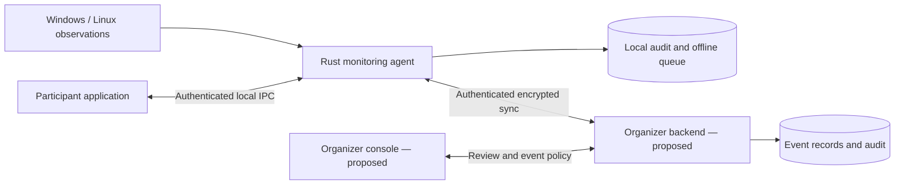

# Anti-AI Guard

**An open-source monitoring system for programming competitions that restrict AI coding assistance.**

Anti-AI Guard aims to let participants use documentation, the internet, terminals, package managers, and legitimate AI development tools while organizers enforce a published restriction on generative AI writing or debugging competition code.

The design combines a pre-event software inventory, runtime observation of recognized coding assistants, and a competition-session policy. Participants retain control of their personal laptops.

> **Current stage: documentation and architecture review.** There is no working monitoring agent, installer, dashboard, or release yet. The features and flows below describe the proposed system. Detection and performance targets have not been validated.

## Explore the project

- [Competition policy](#competition-policy)
- [How it is intended to work](#how-it-is-intended-to-work)
- [Proposed architecture](#proposed-architecture)
- [Scope and privacy](#scope-and-privacy)
- [Development roadmap](#development-roadmap)
- [Working in small chunks](#working-in-small-chunks)
- [Contributing](CONTRIBUTING.md)

## Why this project exists

Restricting AI coding assistance involves more than checking which applications are installed. Coding assistants can run as desktop applications, CLI tools, package-manager entry points, or background services. Meanwhile, a participant may legitimately need Python, Node.js, model files, or a local inference runtime for their competition project.

Anti-AI Guard separates **installation**, **observed execution**, and **policy decisions**. It targets recognized tools and explainable evidence without treating an entire development environment as prohibited.

The earlier design discussion used the name **Anti-LLM Guard**. This repository uses **Anti-AI Guard** for the same project.

## Competition policy

### Policy A: installation is allowed; prohibited execution is restricted

Participants may keep previously installed coding assistants. Installation alone is not a violation.

| Observation | Intended response |
| --- | --- |
| A recognized coding assistant is installed but inactive | Inventory only; no installation-based penalty |
| A prohibited coding assistant is running before admission | Request closure and repeat the relevant checks |
| Prohibited execution is confirmed during a verified session | Record evidence, notify the participant, and suspend verified status |
| Evidence is ambiguous | Request review; no automatic disqualification |
| A local runtime or model file is present | Inventory separately; no automatic violation |
| Essential monitoring becomes unavailable | End verified status with a distinct monitoring-failure reason |

Internet access, documentation, Git, npm, pip, compilers, and traditional autocomplete remain permitted. Legitimate AI project development and model inference remain permitted under the event's declared usage rules.

**The system will not automatically uninstall software, delete files, or terminate personal applications.** Competition penalties and disqualification remain organizer decisions under published rules.

## How it is intended to work

1. **Enroll and consent.** The participant joins an event, sees its rules and inspection scope, and explicitly accepts monitoring.
2. **Check capabilities.** The agent checks platform support, inspection permissions, collector readiness, and policy/signature validity.
3. **Start observation before scanning.** Runtime observation starts before the initial scan completes, reducing the admission gap.
4. **Run preflight.** Targeted collectors inventory supported installations, observable active processes and services, approved storage, and known model directories. Events arriving during the scan are reconciled.
5. **Evaluate admission.** Installed inactive tools remain inventory findings. Active prohibited tools require closure. Incomplete required coverage cannot produce a verified session.
6. **Monitor the session.** Recognized process launches, health checks, storage events, and periodic targeted rescans feed the detection and policy engines.
7. **Explain and review.** Findings produce a reasoned session decision and a minimal audit record. Organizer-authorized reinstatement requires a fresh preflight.

This is **detection followed by competition-session enforcement**. It is not guaranteed operating-system execution prevention: a process may start and perform work before it is detected.

## Proposed architecture

The endpoint is planned as a **Rust agent running in user mode**, with separate Windows and Linux collectors. A custom kernel driver is outside v1.

| Component | Responsibility |
| --- | --- |
| Platform collectors | Observe installations, processes, services, storage, and targeted model artifacts; report visibility gaps |
| Detection and correlation engine | Combine supported executable identity, package metadata, hashes, entry points, and process context |
| Policy and session controller | Apply event rules to evidence, admission, and health; explain each state transition |
| Health supervisor | Track collector continuity, permission loss, event loss, policy validity, and logging failures |
| Local event store | Retain minimal evidence and queue synchronization within a defined retention limit |
| Participant application | Present consent, findings, closure requests, notifications, and monitoring status |
| Organizer backend and console | Manage enrollment, policy distribution, heartbeats, authoritative event records, and review |

The backend is proposed as one application with a relational database; its implementation stack and first-release scope remain open. These are module boundaries, not a commitment to separate microservices.

[Open the editable architecture draft in FigJam](https://www.figma.com/board/khHS1yqPXt0D38dX142iFe). This README remains the public entry point if access to the board is restricted.

### Session eligibility

| State | Meaning |
| --- | --- |
| **Not Verified** | Admission has not passed, or the session has stopped |
| **Verified** | Admission passed and required monitoring is operational |
| **Action Required** | A preflight conflict, coverage gap, or ambiguous policy issue needs attention |
| **Suspended** | Confirmed prohibited execution or essential monitoring loss ended verified status |
| **Under Review** | An authorized organizer is evaluating evidence and context |

Monitoring health and network connectivity are tracked separately from eligibility. An offline queue does not, by itself, authorize offline participation. Missing heartbeats must eventually expire organizer-facing verification; the deadline and reconnection rules still need agreement.

## Scope and privacy

### Planned v1 coverage

- Inventory supported installations of Codex CLI, Claude Code, OpenCode, Cursor, and subsequently documented coding tools.
- Observe recognized native, package-manager-launched, and background execution paths where platform telemetry supports them.
- Inventory local runtimes such as Ollama and LM Studio separately from coding assistants.
- Inspect known, scoped model directories for artifact indicators without reading model contents.
- Observe supported mass-storage attachment and removal, distinguishing storage from ordinary USB input devices.
- Maintain health reporting, local audit records, and participant-facing explanations.

These are coverage goals, not a statement that all versions or installation methods are detectable. A platform and installation-variant matrix must define supported cases before implementation claims are made.

### Privacy commitments

- Explicit participant consent and a disclosed inspection scope.
- No keystroke capture, terminal-history collection, source-code capture, or personal-document inspection in v1.
- Targeted discovery rather than whole-disk content scanning.
- Inspect necessary process launch metadata locally; avoid storing or uploading full command lines by default because they can contain private data.
- Minimal evidence: timestamps, relevant identity, rule/policy versions, observation source, evidence class, execution status, and policy action.
- Bounded retention, controlled organizer access, and a documented review process.
- Participants can stop monitoring; doing so ends verification without preventing normal computer use.

### Known limits

Known signatures can miss renamed, modified, or custom agents. Generic Python or Node.js programs can call model APIs without revealing whether they assist coding or implement a legitimate project feature.

User-mode monitoring cannot guarantee integrity against hostile administrator/root access. Some metadata requires additional privileges. Polling can miss short-lived processes, so event telemetry, reconciliation, and measured coverage are needed. Incomplete inspection must be reported explicitly.

Browser assistance, IDE extension controls, VM/WSL/container coverage, and activity on separate devices are not covered by the initial endpoint design. Detecting an IDE process does not establish which of its features was used.

## Development roadmap

Each milestone will be split further into reviewable changes. This roadmap describes planned work, not implemented functionality.

| Milestone | Deliverable | Status |
| --- | --- | --- |
| **M0 — Public foundation** | README, MIT license, contribution workflow, and architecture draft | Complete |
| **M1 — Coverage and design** | Supported OS/privilege matrix, evidence rules, threat boundaries, and acceptance plan | Next |
| **M2 — Read-only preflight** | Rust structure, detection interfaces, installation/process inventory, reports, and tests | Planned |
| **M3 — Runtime observation** | Process-event collectors, reconciliation, health checks, and failure reporting | Planned |
| **M4 — Session and audit** | Policy transitions, bounded local persistence, notifications, and synchronization contract | Planned |
| **M5 — Organizer workflow** | Enrollment, heartbeats, evidence review, and participant/organizer interfaces | Proposed scope |
| **M6 — Controlled validation** | Windows/Linux acceptance results, measured performance, privacy checks, and release documentation | Planned |

Before implementation, we need to settle supported OS versions and Linux distributions, participant privileges, offline verification rules, backend release scope, and whole-application versus feature-level IDE restrictions.

The initial engineering targets are at least 95% recall for supported known-agent cases, below 2% false positives across representative benign sessions, and detection of observable prohibited launches within five seconds. **These are unmeasured targets, not achieved results.**

## Working in small chunks

We will build this project incrementally:

1. Define one concrete outcome and its acceptance criteria.
2. Make a focused change with an understandable diff.
3. Run checks appropriate to that change and report what remains untested.
4. Review the result, update the roadmap or decisions, and make a descriptive commit.
5. Push the completed chunk before starting the next agreed piece of work.

Use short-lived branches and pull requests as collaboration grows. Commit messages should explain the change, for example `docs: define process evidence rules` or `feat: add read-only package inventory`. Working features will be documented only after they exist and are validated.

There is no installation or run command yet. The first implementation milestone will introduce those instructions alongside working code.

## Contributing

Architecture feedback, platform research, acceptance scenarios, and documentation improvements are welcome now. Please read [CONTRIBUTING.md](CONTRIBUTING.md) before proposing a change.

Use synthetic or redacted examples in public issues. Do not upload participant inventories, private command lines, credentials, model prompts, or personal files.

## License

[MIT](LICENSE) — Copyright (c) 2026 Piyush Gupta.
