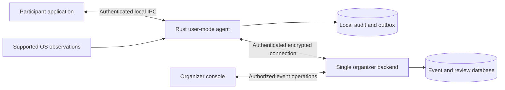
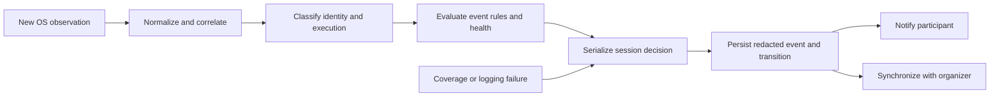

# Anti-AI Guard v1: detailed system architecture

Version: 0.3 | Updated: 2026-10-28 | Status: draft for review

This is the proposed complete v1 design, not a description of implemented software. Policy A, user-mode execution, Windows/Linux targets, and the privacy constraints are established requirements. Module contracts, deployment details, API routes, and failure policies below are proposals pending review and measurement.

[Project overview](../README.md) | [Editable architecture board](https://www.figma.com/board/khHS1yqPXt0D38dX142iFe)

M1 update: the maintainer selected native Windows 10 and Windows 11 for the first prototype. Linux is deferred to later v1 work. The [coverage matrix](coverage-matrix.md) and [acceptance plan](acceptance-plan.md) define the proposed standard-user baseline, candidate lab configurations and M2 gates. No platform or detector has been validated yet. Existing FigJam overview notes should be read with this newer scope decision.

## 1. Scope and architectural invariants

Anti-AI Guard observes supported evidence on consenting participants' laptops and manages competition verification. It does not promise to prevent every AI workflow or determine the intent of arbitrary model calls.

The following rules apply throughout the design:

1. Installed inactive coding assistants are inventory, not violations.
2. Prohibited execution requires a supported identity finding and an applicable event rule.
3. Incomplete required coverage cannot be presented as verified monitoring.
4. Normal terminals, interpreters, compilers and package managers remain usable.
5. No automatic uninstall, file deletion, process termination or disqualification.
6. Consent is required before inspection. Participants can stop monitoring.
7. No keystrokes, terminal history, source code or personal-document capture.
8. Evidence is minimized and findings explain their source and limitations.
9. A backend must stop presenting a silent or stale endpoint as currently verified.
10. Restoring telemetry or closing a tool does not automatically clear a suspension.

## 2. Deployment boundaries

| Boundary | Proposed deployable unit | Responsibility |
| --- | --- | --- |
| Participant device | Participant application | Consent, enrollment, findings, notifications, review request and stop action |
| Participant device | Rust monitoring agent | Collection, identity analysis, local policy decisions, health and audit |
| Organizer infrastructure | One backend application | Enrollment, policy distribution, ingestion, heartbeats, authoritative event records and review |
| Organizer infrastructure | Relational database | Durable event, consent, finding, transition and organizer audit records |
| Organizer browser | Organizer console | Event configuration and authorized review through backend APIs |

The API layer is part of the proposed backend application, not another microservice. Detection, health and synchronization are modules inside the agent, not separate network services.

Local persistence uses an embedded transactional store; SQLite is a candidate, not a selected dependency. Backend language, UI framework, hosting and database product remain open. No message broker is required for the initial design.

### Ring 3 and privilege model

The agent and interfaces run in user mode. Elevation to administrator/root does not make an application Ring 0. There is no custom kernel driver in v1.

Default to minimum required read access. Probe and disclose capabilities before enrollment is verified. If a required collector needs elevation, offer a disclosed, supported configuration or deny verification for that event; do not silently escalate or weaken its coverage requirements.

An optional privileged collector helper is a future design decision within v1 investigation, not an assumed component. If justified, it must have a narrow read-only IPC contract, its own capability reporting, and independent security review.

## 3. Endpoint modules and contracts

| Module | Input | Output / responsibilities |
| --- | --- | --- |
| Consent and configuration | Event enrollment and participant acceptance | Consent receipt, scoped inspection configuration and session identity |
| Policy/catalog manager | Versioned policy and signed signatures | Validated immutable configuration snapshot; expiry and rollback checks |
| Capability manager | OS configuration and collector probes | Supported, degraded, unavailable or not-required capability entries |
| Installation collector | Approved roots, PATH and supported installation metadata | Installation observations with source, scope and access failures |
| Process collector | Snapshot and supported launch/exit telemetry | Process-instance observations, continuity indicators and dropped-event reports |
| Service collector | Relevant supported service metadata | Registered/running service observations; unknown ownership reported |
| Storage collector | Supported mass-storage inventory/events | Attachment, removal, approval status and scoped scan requests |
| Runtime/model collector | Declared runtime and known model roots | Runtime/model indicators, separate from coding-assistant execution |
| Normalizer | Collector-specific observations | Versioned common event envelope and explicit missing fields |
| Identity and correlation engine | Normalized evidence and signature snapshot | Inventory, candidate or supported execution finding with supporting facts |
| Policy evaluator | Finding, event rules, coverage and session context | Reasoned decision; no direct process-control side effects |
| Session controller | Decisions and authorized commands | Serialized eligibility transitions and local notifications |
| Health supervisor | Collector health, event continuity and storage status | Health transitions and admission/runtime invalidation requests |
| Audit/outbox | Redacted observations, findings and decisions | Transactional audit records and retryable synchronization batches |
| Backend synchronizer | Outbox, acknowledgments and connectivity | Authenticated uploads, retry/backoff and authoritative session updates |
| Participant IPC | Authenticated local UI requests | Consent, scan/start/stop/review requests and read-only status responses |

Only the session controller mutates local eligibility. The backend applies its own authoritative event transitions; the UI cannot grant either status. Queue saturation, collector crashes and parsing failures become health evidence rather than silent event drops.

## 4. Collector scope and platform coverage

| Inspection | Windows adapter candidates | Linux adapter candidates | Required limitation handling |
| --- | --- | --- | --- |
| Installations | Supported application records, PATH, known user/system installation roots | PATH, known user/system roots and supported package metadata | Custom prefixes and portable tools require documented variants |
| Process snapshot | Supported process enumeration and permitted identity queries | Scoped procfs process metadata | Access denied and disappearing processes are distinct results |
| Process events | Investigate supported native event sources and their privileges | Investigate supported event sources and their privileges | Polling alone is reduced coverage for short-lived launches |
| Services | Relevant service configuration and observed process identity | Supported service-manager metadata and observed process identity | Registered service is not proof it executed |
| Storage | Mass-storage inventory and device-change notifications | Supported device inventory and event notifications | A keyboard, mouse or headset is not mass storage |
| Model artifacts | Explicit known model roots and participant-approved roots | Explicit known model roots and participant-approved roots | File existence establishes an indicator, not coding assistance |

These are investigation boundaries, not API commitments. Windows process access depends on requested rights and security descriptors; Linux procfs visibility depends on permissions and configuration. See [Microsoft's process-access documentation](https://learn.microsoft.com/en-us/windows/win32/procthread/process-security-and-access-rights) and [Linux procfs documentation](https://docs.kernel.org/filesystems/proc.html).

Each tested configuration needs an OS version, privilege level, collector/version, observable scope, event-loss behavior and acceptance results. Windows 10 and Windows 11 are selected for the first prototype; Linux remains a later v1 target. Specific lab releases and x64 coverage are proposed in the coverage matrix. Do not label a configuration supported based only on compilation or unit tests.

## 5. Process identity and evidence quality

A PID alone is insufficient because identifiers can be reused. Correlate a process instance using a boot/session identifier, PID and observed start time where available. If start identity is unavailable, downgrade correlation and disclose the limitation. Ancestry is supporting evidence; a parent shell is not an assistant.

Process identity checks are layered:

1. Observe executable identity and a normalized executable location.
2. Match supported package metadata or a recognized package entry point where available.
3. Check supported executable hashes or publisher metadata when the relevant rule requires them.
4. Correlate the active process and its launch context with the installation artifact.
5. Emit the evidence class and exact rule version, including missing corroboration.

Metadata in participant-writable directories can be forged. A filename, path or package name alone must not be treated as cryptographic proof. A matching executable hash improves known-version identity but does not establish a process's purpose or total monitoring integrity.

| Evidence class | Meaning | Default policy treatment |
| --- | --- | --- |
| Inventory indicator | Installation, runtime or model artifact observed | Inventory only |
| Candidate identity | Weak or incomplete identity evidence | Review; no automatic execution violation |
| Corroborated identity | All checks required by a documented multi-signal rule passed | Apply event execution policy only if that rule is approved for automatic action |
| Confirmed supported identity | A strong supported identity rule passed, such as a recognized executable hash | Apply event execution policy when actual execution is observed |

Hashes must be tied to the observed executable artifact. Cache entries need stable file identity/change indicators and invalidation on changes; a stale path-based hash must not substantiate a new process. Races and inaccessible artifacts downgrade evidence.

Do not detect execution from arbitrary command substrings. `echo codex`, opening a document about Claude, or ordinary npm/Python activity are required negative cases. A visible package-runner command is insufficient if the identity rule's required corroboration cannot be obtained.

## 6. Preflight and admission protocol

The following sequence assumes the proposed connected event mode. A standalone local report is diagnostic and does not grant organizer verification.

1. Enroll a device/session and obtain the event's versioned policy.
2. Display scope and record participant consent; refuse collection before consent.
3. Validate policy/catalog authenticity, supported versions and expiry.
4. Probe required capabilities and local audit availability.
5. Start required event collectors and receive readiness/continuity confirmation.
6. Capture a time-bounded process/service snapshot and targeted installation/storage inventory.
7. Reconcile events observed while snapshots/scans were running.
8. Classify active findings and coverage. Request closure/recheck for pre-existing prohibited activity.
9. Persist the local admission report and monitoring checkpoint.
10. Send the report for backend evaluation. The backend grants a fresh verification lease only when its rules pass.
11. Recheck local health and intervening events before displaying the effective verified state. A stale grant cannot override a newer local invalidation.

Use a scan identifier, policy/catalog versions, checkpoint sequence and coverage summary to bind admission to the observed interval. Starting monitoring early reduces the time-of-check gap but cannot guarantee that every launch was observed.

If a tool starts during preflight, evaluate it as pre-admission activity unless evidence establishes it occurred after the authoritative verified interval began. If ordering is uncertain, mark the evidence interval uncertain and request review. Do not fabricate exact timing.

## 7. Competition-time decision flow

Confirmed prohibited execution during an effective verified interval invalidates local verification immediately. Successful persistence precedes declaring the resulting audit action complete. If persistence fails, verification still ends and the UI reports that evidence logging failed; the backend lease expires if no durable update can be delivered.

Keep a suspension latch and a monotonically increasing session revision. Closing an agent, receiving an old heartbeat, restarting the UI or replaying a prior admission reply cannot clear the latch. Reinstatement requires an authorized organizer decision and fresh preflight.

Deduplicate repeated observations for the same process instance and rule without suppressing distinct launches. Reconciliation snapshots detect missed persistent activity; they do not prove absence of short-lived activity between samples.

## 8. Eligibility, health and connectivity

| Dimension | Values | Owner |
| --- | --- | --- |
| Local eligibility | Not Verified, Verified, Action Required, Suspended, Under Review | Agent session controller |
| Authoritative event eligibility | Same labels plus revision, reason and evidence references | Backend |
| Monitoring health | Starting, Healthy, Degraded, Unavailable | Agent health supervisor |
| Connectivity | Online, Offline | Synchronizer |
| Verification freshness | Fresh lease or expired | Backend; endpoint checks its locally received lease |

Effective verification requires local admission, all mandatory capabilities, functioning required logging, no unresolved suspension, and a fresh organizer lease under the event's connectivity policy. Optional collector failure may be reported as degraded without ending verification if the published event policy explicitly allows it.

| Trigger | Transition / outcome |
| --- | --- |
| Installed inactive assistant | No adverse eligibility transition |
| Required coverage missing before admission | Action Required / Not Verified |
| Prohibited assistant active before admission | Action Required; request closure and recheck |
| Valid preflight and fresh backend grant | Verified |
| Confirmed prohibited launch while verified | Suspended: prohibited execution |
| Essential telemetry or audit lost while verified | Suspended: monitoring unavailable |
| Ambiguous runtime identity/device conflict | Action Required or Under Review; do not assert confirmed cheating |
| Participant stops monitoring | Not Verified with an explicit stop reason |
| Organizer authorizes reinstatement | Not Verified until a new admission protocol passes |

## 9. Offline behavior and heartbeat leases

Offline logging and offline eligibility are different capabilities. The proposed default requires connectivity for admission. A configurable reconnect grace period is an open policy decision, not permission for indefinite offline verification.

Heartbeats carry session identity/revision, collector health, last processed event sequence, policy/catalog versions and audit/outbox status. The backend uses its receive time for freshness, not the endpoint's wall clock. Local durations use a monotonic clock where available; store wall-clock timestamps with their uncertainty for human review.

The backend rejects replayed sequence numbers and never lets a heartbeat clear a suspension. A heartbeat is a liveness assertion from a partially trusted endpoint, not proof that every collector is honest.

The agent cannot report its own termination. Lease expiry must therefore invalidate organizer-facing verification independently. On restart, record a new agent instance and the monitoring gap, then require new preflight. Do not silently resume verified status.

## 10. Evidence schema and local persistence

Proposed logical records:

| Record | Minimum relevant fields |
| --- | --- |
| ConsentReceipt | Participant/session, accepted scope, policy version, accepted time |
| CapabilityReport | OS/configuration, collector, required status, observable scope and failure reason |
| Observation | Schema version, event ID, sequence, source, observed time, process-instance reference and availability flags |
| Finding | Finding ID, observation references, tool category, evidence class, rule/catalog version and redacted explanation |
| PolicyDecision | Decision ID, finding/health references, policy version, action, reason and session revision |
| SessionTransition | Previous/new eligibility, revision, actor, timestamp and supporting references |
| HealthEvent | Collector/audit failure, continuity interval and severity |
| ReviewDecision | Organizer identity/role, reason, evidence references and reinstatement authorization |
| OutboxEntry | Session/event ID, sequence, payload schema, retry state and acknowledgment |

The source event, decision, transition and corresponding outbox entries should be committed atomically when a decision changes eligibility. A crash after commit must allow replay without duplicating decisions.

Keep observation metadata locally only as long as needed. A persisted observation is already minimized; the outbox is not a copy of raw process command lines. Do not use environment variables or full command strings as default evidence fields. Prefer rule IDs, recognized package/executable identity and redacted explanations. Absolute paths can expose usernames and project names; normalize or redact them before persistence unless a documented finding needs a scoped path.

Local credentials belong in supported OS credential storage, separate from the event database. File permissions restrict ordinary-user access where possible; encryption at rest does not create protection against a hostile device administrator.

Retention periods, byte limits, deletion after an event, and appeal-related preservation need explicit policy values before implementation. No unbounded logs or queues.

## 11. Synchronization protocol

1. Read durable outbox batches in session sequence order.
2. Authenticate using a device/session-scoped credential over encrypted transport.
3. The backend validates schema, ownership, event identity, policy references and payload bounds.
4. Commit accepted records and corresponding authoritative transitions transactionally.
5. Return explicit acknowledgments and the authoritative session revision/status.
6. Mark acknowledged outbox entries delivered; retry unacknowledged entries with bounded exponential backoff and jitter.

Use event IDs scoped to device/session for idempotency. A retried batch must not create duplicate findings, penalties or review actions. A sequence gap remains a coverage concern until explained or recovered. Out-of-order receipt is retained with ordering metadata, never silently interpreted as proof of event timing.

Network loss does not stop local invalidation. When the outbox reaches its configured limit, do not discard mandatory audit events to keep a green status; end verification and disclose the logging/synchronization limitation.

## 12. Organizer backend and interface contracts

Proposed API responsibilities, not frozen routes or implemented endpoints:

| Contract | Request / response behavior |
| --- | --- |
| Enrollment | Bind event, participant and device to a short-lived session credential |
| Policy/catalog retrieval | Return authenticated versioned configuration and signed catalog artifacts |
| Admission | Evaluate consent, capabilities, findings and checkpoint; return a revision-bound lease or reasons for refusal |
| Heartbeat | Validate session revision and liveness; return authoritative status without clearing unresolved findings |
| Event batch | Validate and persist idempotent evidence/transition records; acknowledge accepted IDs/sequences |
| Review request | Link participant explanation to specific findings without modifying evidence |
| Organizer decision | Authorize actor and event role; record reason and append a new review/eligibility transition |
| Event closure | End verification, revoke credentials and schedule retention processing |

Backend role checks distinguish participant, event reviewer and event administrator. Reviewers may evaluate assigned event evidence; only authorized roles may alter event policy or authorize reinstatement. Clients cannot assign themselves roles or submit an authoritative organizer decision.

No direct database access from either UI. Organizer evidence queries should be scoped, paginated, redacted and audited. A participant UI must not expose administrative functions through local IPC.

## 13. Local IPC boundary

Candidate transports are Windows named pipes and Linux Unix-domain sockets, subject to implementation review. Restrict peer access using OS identities/ACLs and authenticate the enrolled UI/session. Never expose the agent's control interface as an unauthenticated public TCP listener.

Allowlist commands: read status, consent/enroll, request scan, request session start, stop monitoring and submit a review request. Validate message sizes, schema versions, session revision and request IDs. The UI cannot write arbitrary files, run shell commands, disable individual required collectors while remaining verified, or clear suspension.

Closing the UI should leave the agent operational and discoverable; explicitly stopping monitoring is a separate participant action. The exact service/user-session packaging remains open and must preserve consent, visibility and uninstallability.

## 14. Signatures, event policies and updates

A signature catalog entry includes tool ID/category, installation variants, identity predicates, required evidence class, rule version and known limitations. Model/runtime classification is separate from dedicated coding-assistant classification.

Catalog and policy validity are independent from tool identity. A signed catalog authenticates its distributor, not the truth of participant-controlled metadata. Do not execute discovered binaries or package lifecycle scripts to determine their identity.

Pin the policy/catalog versions for an active session. Proposed default: apply ordinary updates between sessions. A required emergency update must explicitly end verification and trigger renewed admission; do not silently reinterpret old observations under a new rule. Define key rotation, revocation and minimum-version behavior before release.

## 15. Local inference and removable storage

Local inference may be legitimate project work. A runtime declaration records the approved runtime/category and organizer decision; it is contextual evidence, not a blanket exemption for coding assistants. Avoid allowing a whole interpreter merely because one project uses it.

A listening port alone is insufficient to identify a service. Correlate observable endpoints with owning process identity where supported; record unknown ownership as a limitation. No prompt inspection, traffic decryption or inference-intent classification in v1.

Storage approval applies to mass storage and its scoped inspection roots. Attachment yields a device observation, not automatic cheating. Event rules determine whether an unapproved device needs review or prevents verification. Scan approved roots only; do not recursively follow symlinks or reparse points outside the allowed scope. Bound depth, file count, bytes of metadata and scan time. Scan cancellation or access denial produces an incomplete result.

## 16. Failure and recovery matrix

| Failure | Local behavior | Organizer behavior / recovery |
| --- | --- | --- |
| Agent terminated or laptop sleeps | Cannot guarantee last event delivery | Expire lease; record gap and require new preflight |
| Required collector fails or loses permissions | End verification with a health reason | Record coverage loss; restore and reverify |
| Event queue overflows | Mark continuity gap and invalidate mandatory coverage | Review the affected interval; reconcile persistent activity |
| Process exits before enrichment | Keep observable facts; downgrade identity | No fabricated confirmed identity |
| Outbox/database full or corrupt | End verification; report audit unavailable | Do not treat missing evidence as a clean interval |
| Backend/network unavailable | Continue bounded local collection and invalidate per freshness policy | Show stale status after deadline; reconcile on reconnect |
| Invalid/expired required policy or catalog | Refuse admission or end verification as required | Distribute a valid version and rerun preflight |
| Clock moves backward/forward | Preserve sequence and monotonic durations | Use server receive time for lease freshness; expose timing uncertainty |
| Duplicate/replayed uploads | Reuse idempotent event IDs | Reject or acknowledge duplicates without repeated action |
| Participant closes UI | Agent continues if consent/session remain active | Status remains governed by agent health |
| Participant explicitly stops | End verification and stop collection | Session ends or lease expires; computer remains usable |

## 17. Threat boundaries and exclusions

Treat participant devices and submitted telemetry as partially trusted. Local IPC controls, signatures, sequence checks and audit integrity improve accountability, but cannot defeat an owner with unrestricted administrator/root control. A local hash chain may reveal some edits after a trusted checkpoint; it does not make endpoint evidence tamper-proof.

v1 does not include browser content inspection, IDE extension feature enforcement, custom network traffic inspection, separate-device monitoring, VM/WSL/container coverage, CPU/GPU inference-intent analysis or a kernel driver. Known portable executables are in scope only for documented scanned/observable variants; arbitrary custom assistants are outside guaranteed coverage.

## 18. Quality and validation gates

Validate per supported OS/privilege/installation variant. Proposed test families:

- Detection: inactive install, native execution, supported package entry point, background execution, PID reuse, stale identity cache and disappearing process.
- Benign development: npm install, ordinary Node/Python scripts, Git, compilers, model training and text mentioning an assistant name.
- Admission: activity during scanning, missing required capability, dropped events and stale admission replies.
- Policy: inventory versus execution, ambiguous review, distinct failure reasons and no automatic reinstatement.
- Persistence/sync: crash recovery, duplicate batches, out-of-order events, queue limits and backend outage.
- Privacy/security: command-line redaction, scoped scans, unauthorized IPC/review requests and retention deletion.
- Performance: time to detect an observable launch, missed short-lived events, CPU/memory use, scan duration and disk growth.

The earlier targets remain unmeasured: at least 95% supported-case detection recall, below 2% benign-session false positives and observable launch detection within five seconds. Define denominators, test corpus and confidence intervals before claiming results. Five seconds is not an execution-prevention guarantee.

## 19. Delivery chunks and review order

| Chunk | Output | Exit gate |
| --- | --- | --- |
| A: architecture review | This document and editable views | Agree boundaries and record unresolved decisions |
| B: coverage contract | OS/privilege/installation matrix | Each promised case has observable evidence and a test |
| C: evidence and policy | Fixture-based shared contracts and decisions | Negative cases and state rules pass |
| D: preflight prototype | Read-only inventory/process CLI and report | Real collector results with explicit gaps |
| E: continuous observation | Supported events, reconciliation and health | Measure latency and event loss |
| F: durable sessions | Audit/outbox and recovery behavior | Crash, overflow and replay cases pass |
| G: organizer integration | Admission, lease, sync and review contracts | End-to-end suspension/reinstatement and stale-session tests pass |
| H: interfaces and release | Participant/organizer views and packaging | Consent, stop/uninstall, privacy and supported-platform acceptance pass |

Each row must be split into small reviewable commits. A read-only prototype does not qualify as the complete v1 competition product. Do not begin product implementation until the next chunk is agreed.

## 20. Decisions still required

| ID | Decision | Proposed direction / unresolved point |
| --- | --- | --- |
| V1-D01 | Supported platforms | Maintainer selected native Windows 10 and 11 first; exact validated builds/architectures and later Linux configurations remain to be measured |
| V1-D02 | Privileges | Proposed standard-user M2 baseline; report gaps and investigate elevated diagnostics and future event-source permissions separately |
| V1-D03 | Event-mode authority | Backend leases recommended for organizer verification; standalone mode is diagnostic |
| V1-D04 | Offline rules | Connected admission recommended; agree reconnect grace and lease deadlines |
| V1-D05 | IDE restrictions | Decide whole-app prohibition versus feature controls; feature controls are not currently in scope |
| V1-D06 | Runtime/storage approvals | Choose declaration fields, reviewer authority and unapproved-storage behavior |
| V1-D07 | Evidence lifecycle | Agree retention, queue limits, redaction, appeal preservation and deletion |
| V1-D08 | Packaging and technology | Choose agent lifecycle, UI framework, backend stack and persistence after capability investigation |
| V1-D09 | Catalog governance | Choose signing/revocation owner and what evidence qualifies for automatic suspension |

Review deployment/authority and privileges first, then coverage and evidence rules, then failure handling and retention. These determine what the system can honestly promise.

## 21. Editable views and diagram sources

The original system overview, endpoint pipeline and session state draft remain on the board. The expanded v1 views are organized below them:

| View | Editable FigJam view | Mermaid source |
| --- | --- | --- |
| 05: preflight/admission | [Open view](https://www.figma.com/board/khHS1yqPXt0D38dX142iFe?node-id=21-183) | [preflight-admission.mmd](diagrams/preflight-admission.mmd) |
| 06: runtime suspension/review | [Open view](https://www.figma.com/board/khHS1yqPXt0D38dX142iFe?node-id=22-257) | [runtime-enforcement.mmd](diagrams/runtime-enforcement.mmd) |
| 07: coverage/health/lease failure | [Open view](https://www.figma.com/board/khHS1yqPXt0D38dX142iFe?node-id=25-529) | [coverage-health.mmd](diagrams/coverage-health.mmd) |
| 08: evidence privacy/sync | [Open view](https://www.figma.com/board/khHS1yqPXt0D38dX142iFe?node-id=25-530) | [evidence-sync.mmd](diagrams/evidence-sync.mmd) |

View 09 summarizes invariants and open decisions. FigJam labels are shortened for readability; the written contracts and source diagrams retain the detailed internal checks. Changes to architecture should update the document, relevant diagram source and editable view together.
